# DotDeck

**A tiny, offline, dot-matrix home screen for Android car head units and players.**

DotDeck replaces the stock launcher with a calm, glanceable one: a dot-matrix clock, six big favourite tiles for the apps you actually use while driving (navigation, music, phone, phone-mirroring, camera, and one of your choice), and a fast searchable app drawer. It is about 40 KB, written in plain Java with no libraries, and asks Android for **no permissions at all**: no internet, no location, no microphone, no root.

<p align="center">
  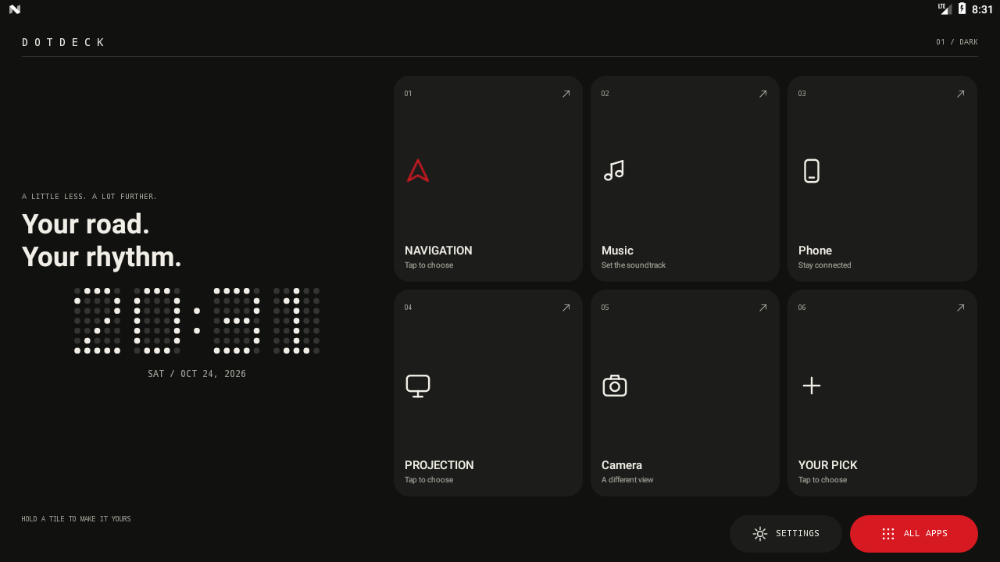
</p>

> **Status: 0.1.0, early.** It builds, passes its tests and runs on an Android 7 emulator. It has **not yet been tested on a real head unit**; vendor firmware varies and some units override the home-screen setting. See [Status and limits](#status-and-limits).

**Quick links:** [Install on your head unit](docs/HEADUNIT_SETUP.md) · [Download](https://github.com/Sienz16/dotdeck/releases) · [Build from source](#build-from-source) · [For AI agents](AGENTS.md)

---

## Contents

- [Why DotDeck](#why-dotdeck)
- [Features](#features)
- [Screenshots](#screenshots)
- [Install](#install)
- [Using DotDeck](#using-dotdeck)
- [Layouts and themes](#layouts-and-themes)
- [Compatibility](#compatibility)
- [Privacy and safety](#privacy-and-safety)
- [Build from source](#build-from-source)
- [Project layout](#project-layout)
- [Tests](#tests)
- [Performance](#performance)
- [Troubleshooting and FAQ](#troubleshooting-and-faq)
- [Status and limits](#status-and-limits)
- [Contributing](#contributing)
- [Using an AI agent to set this up](#using-an-ai-agent-to-set-this-up)
- [Disclaimer](#disclaimer)

## Why DotDeck

Many cheap Android head units ship with a cluttered launcher that is slow on 1 GB of RAM and hard to read at a glance. DotDeck is the opposite:

- **Light.** No dependencies, no background services, no timers except one minute-tick for the clock while Home is showing.
- **Glanceable.** A large dot-matrix clock and big touch targets, readable at arm's length.
- **Private.** Zero permissions. It cannot see your location, your contacts or the network.
- **Yours.** Five layouts and nine themes, mixed freely; six favourites that you choose.
- **Hands-off.** It never modifies firmware properties, kills background apps or touches car services.

## Features

- **Dot-matrix clock** with the date, 24-hour or 12-hour. Tap it to open Android's date settings.
- **Six favourite tiles.** On first run DotDeck guesses sensible apps (Waze or Maps, Spotify or Music, Phone, a phone-mirroring app, Camera, Settings). Change any tile by tapping it (if empty) or holding it.
- **Searchable app drawer**, alphabetical, with live filtering. Hold an app to set it as a favourite or open its Android App info. Icons in monochrome or original colours.
- **Five home layouts**: DECK, DOCK, LIST, BENTO, STRIP, each adapting to landscape, portrait and small screens.
- **Nine themes** (colours, corner shape, border and dot style): DARK, LIGHT, VOID, MILK, SIGNAL, TERMINAL, AMBER, BLUEPRINT, EMBER. Every colour pair is contrast-tested.
- **Optional one-shot animations**: tiles rise in when a page opens, tiles squeeze while pressed, the clock's dots sweep to the new minute. Nothing loops. They turn off with one switch, or automatically when Android's animation scale is 0.
- **Shortcuts** to the default-home chooser, display, Wi-Fi, Bluetooth, device info and Android's own Settings, plus a device-RAM snapshot.
- **Direct-boot aware**: settings are readable before the first unlock after a cold start.
- **Stays current**: the app list refreshes when you return to Home and whenever an app is installed, updated or removed.

## Screenshots

### Five layouts

| DECK | DOCK |
| :---: | :---: |
|  | 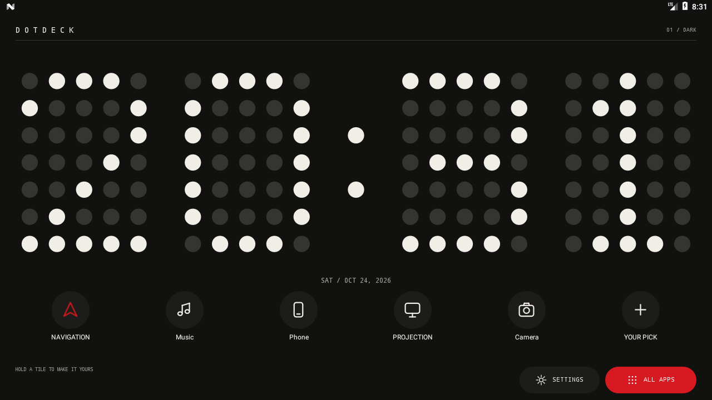 |
| Clock and headline left, six cards right. | A huge clock with a row of round buttons. |

| LIST | BENTO |
| :---: | :---: |
| 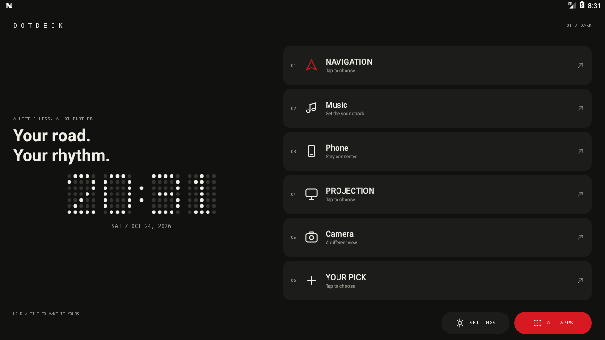 | 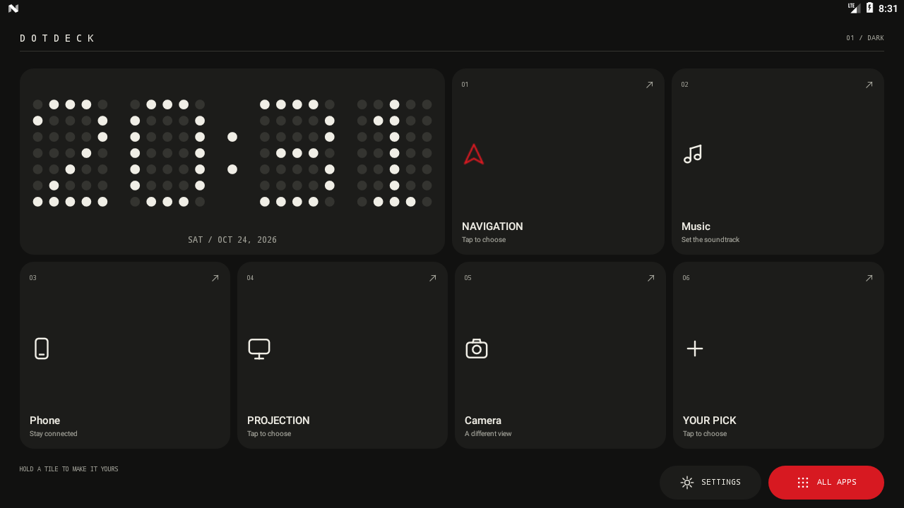 |
| Clock on one side, six wide rows on the other. | The clock is a double-width tile in a box grid. |

| STRIP | BENTO in portrait |
| :---: | :---: |
| 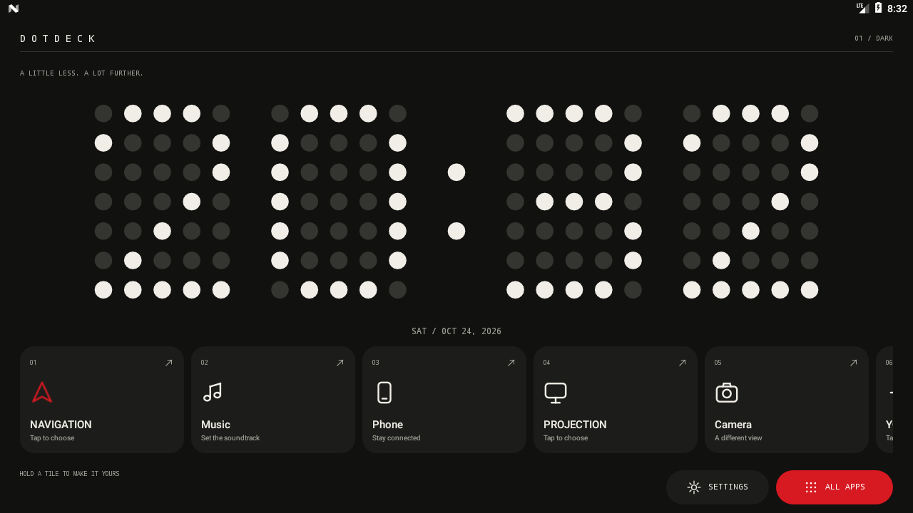 | 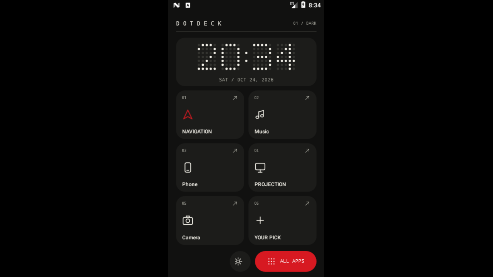 |
| A large clock above a swipeable row of cards. | Every layout adapts to portrait and small screens. |

### Nine themes (shown on DECK; any theme works with any layout)

| | | | |
| :---: | :---: | :---: | :---: |
| <br>**DARK** | 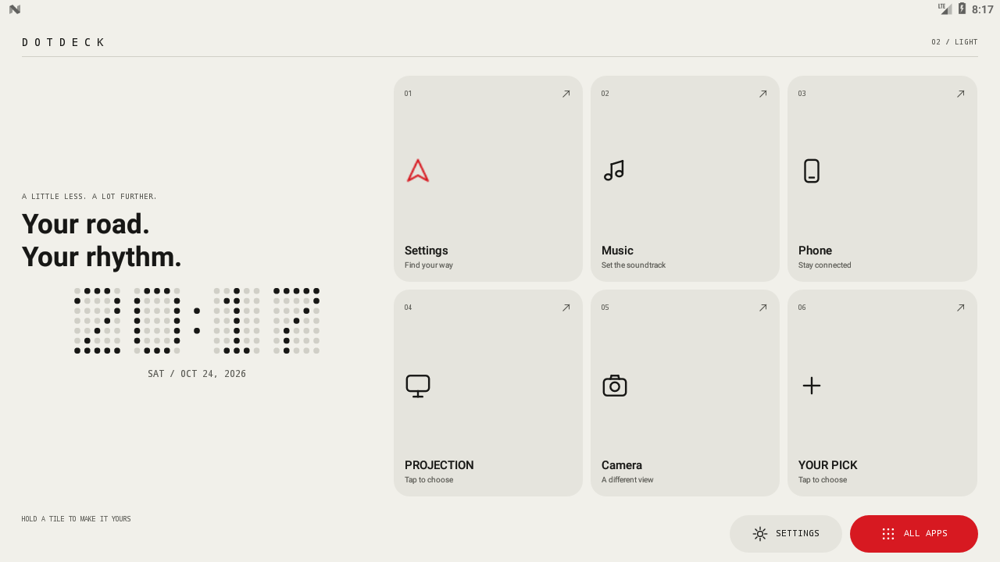<br>**LIGHT** | 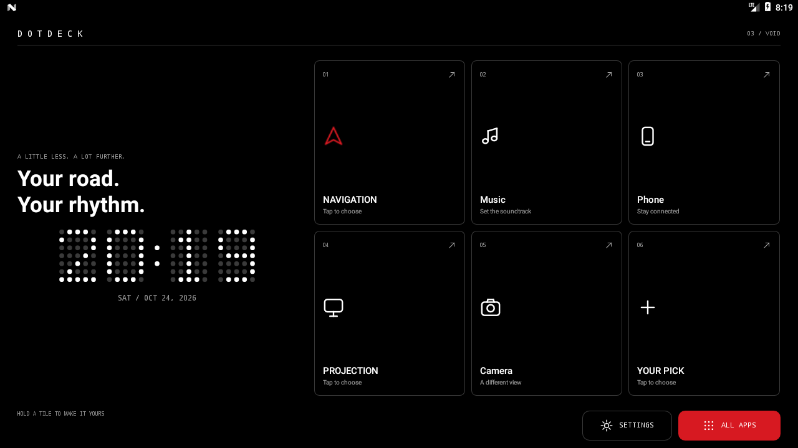<br>**VOID** | 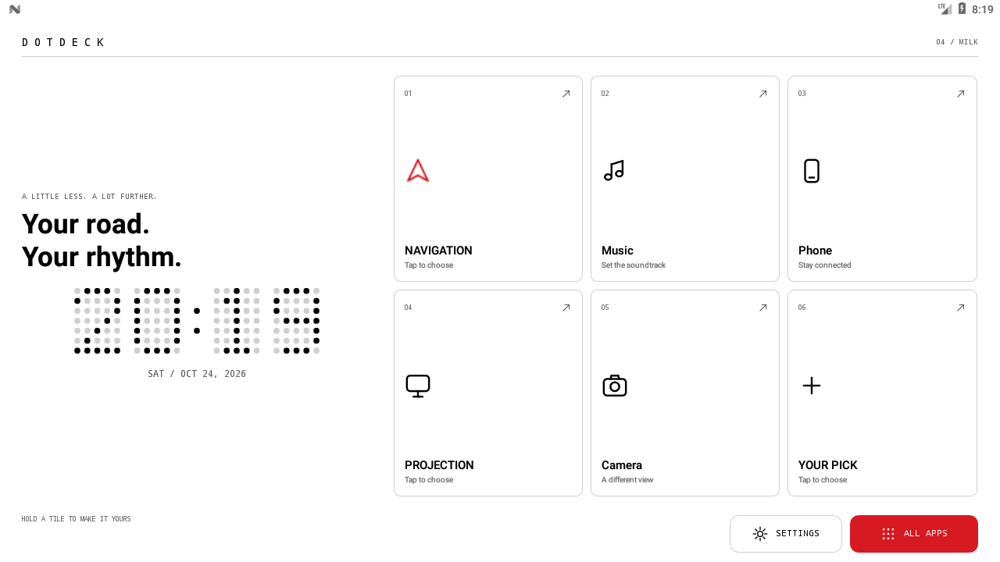<br>**MILK** |
| 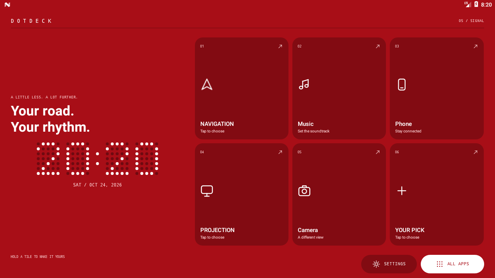<br>**SIGNAL** | 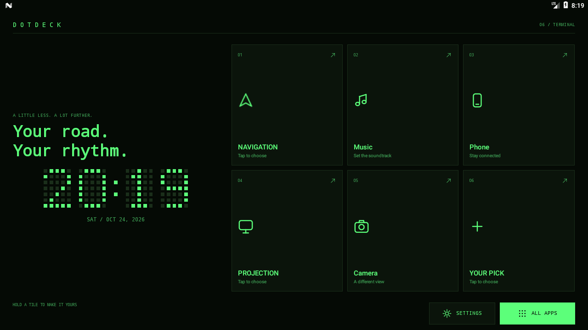<br>**TERMINAL** | 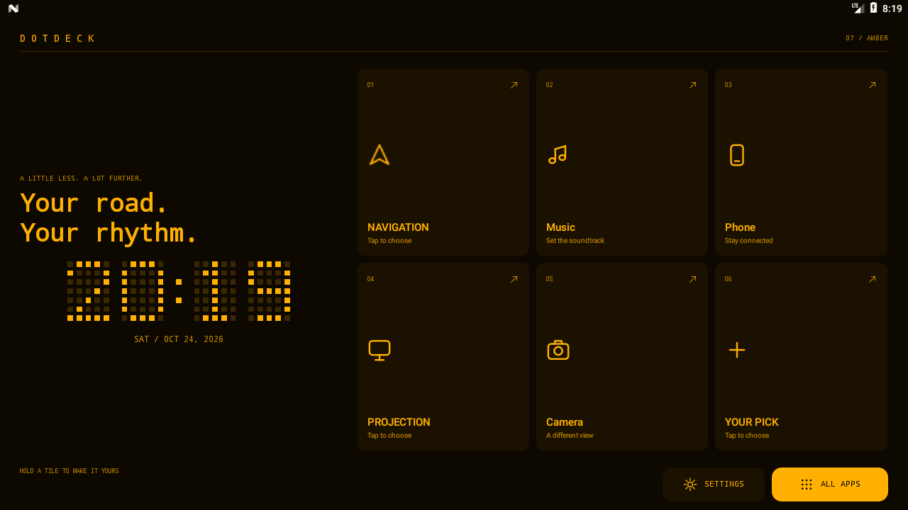<br>**AMBER** | 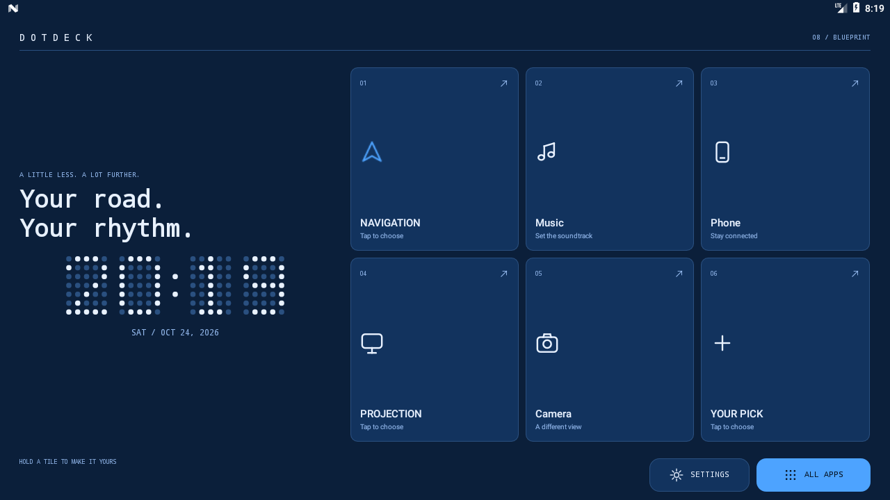<br>**BLUEPRINT** |
| 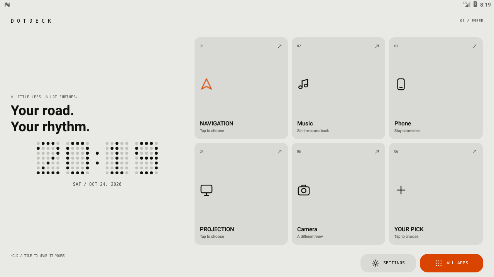<br>**EMBER** | | | |

### Settings and app drawer

| Settings: theme and layout pickers | ALL APPS |
| :---: | :---: |
| 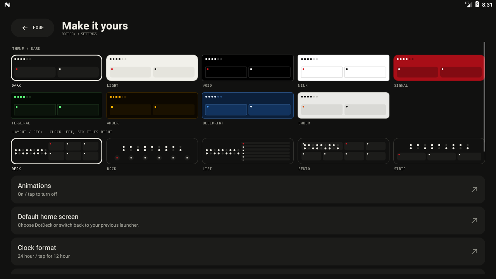 | 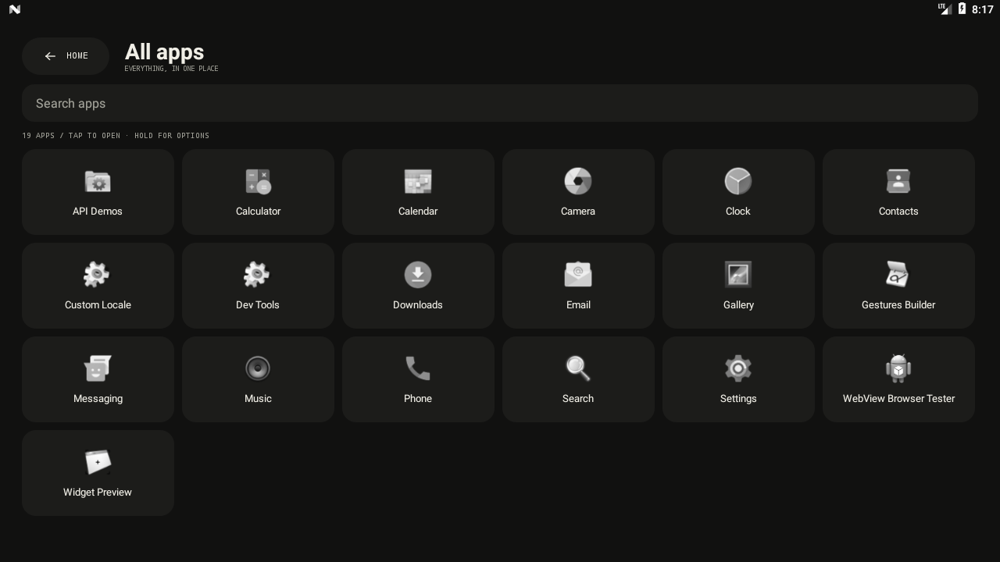 |

*Screenshots are from an Android 7 emulator at 1280x720.*

## Install

You need an Android head unit or player running **Android 7.0 or newer**.

1. **Download** `dotdeck-<version>.apk` from the [Releases page](https://github.com/Sienz16/dotdeck/releases).
2. **Install** it: copy it to a USB stick and open it in the unit's File Manager, or use ADB from a computer.
3. **Make it the home screen**: open DotDeck, then SETTINGS, then **Default home screen**.

The full walkthrough, including how to enable debugging on a head unit, install over USB or Wi-Fi, set the default home app, tune it for your screen, and **get back to your old launcher**, is in:

### 👉 [docs/HEADUNIT_SETUP.md](docs/HEADUNIT_SETUP.md)

> **Park the car for the first install** and know how to switch back before you change the default home screen. The guide explains how.

## Using DotDeck

### Home

- **Header:** `D O T D E C K` and the current theme (for example `01 / DARK`).
- **Clock:** the dot-matrix time and the date. Tap for Android's date settings.
- **Six tiles:** tap to open the app. An empty tile opens the app list so you can pick one.
- **Hold a tile:** *Choose app* or *Clear tile*.
- **Footer:** **SETTINGS** and **ALL APPS**.
- The Android back button returns from Settings and ALL APPS to Home. On Home it does nothing, as a launcher should.

### ALL APPS

A grid of every installed app that has a launcher icon, A to Z. Type to filter by name or package. **Tap** to open. **Hold** for *Set as favourite* or *App info*. When you arrive from an empty tile, the title becomes **Choose your app** and a tap assigns the app to that tile. Assigning an app that is already on another tile swaps the two tiles.

### Settings

| Setting | What it does |
| --- | --- |
| **Theme** | Pick one of nine colour themes from live previews. |
| **Layout** | Pick one of five home layouts from wireframe previews drawn in your theme. |
| **Animations** | Turn the one-shot animations on or off. |
| **Default home screen** | Choose DotDeck, or switch back to your previous launcher. |
| **Clock format** | 24 hour or 12 hour. |
| **App icons** | Monochrome or original colours. |
| **Brightness & display, Wi-Fi, Bluetooth, System settings, Device** | Shortcuts to Android's own screens, and a snapshot of device RAM. |

## Layouts and themes

**Layout** decides *where things are*. **Theme** decides *how they look*. They are independent, so 5 x 9 combinations are possible.

| Layout | Idea | Good for |
| --- | --- | --- |
| **DECK** | Clock and headline on one side, a 3x2 grid of cards on the other. | A balanced default. |
| **DOCK** | A very large clock with a single dock of round glyph buttons. | Reading the time at a glance. |
| **LIST** | Clock on one side, six wide rows on the other. | Easy, predictable touch targets. |
| **BENTO** | The clock is a double-width tile among the six cards. | A dense, tidy grid. |
| **STRIP** | A large clock above a row of cards you can swipe sideways. | Keeping the clock big. |

| Theme | Character |
| --- | --- |
| **DARK** / **LIGHT** | The default dark and its light counterpart. |
| **VOID** / **MILK** | True black and paper white, with hairline-bordered tiles. |
| **SIGNAL** | Red field, white ink. |
| **TERMINAL** | Green phosphor, square dots, hard edges, monospace headlines. |
| **AMBER** | Amber segment display, like an old dash cluster. |
| **BLUEPRINT** | Navy, pale lines, cyan highlight. |
| **EMBER** | Warm grey with an orange accent. |

Adding your own is a small code change; see [Contributing](#contributing).

## Compatibility

| | |
| --- | --- |
| **Android version** | 7.0 (API 24) and newer. Built against API 35. |
| **Device** | A normal Android device with a touch screen. Not an Android Auto projection app; not an Android Automotive OS replacement. |
| **Screens** | Landscape first (1024x600, 1280x720, 1920x1080 and similar); portrait and small screens adapt. |
| **Permissions** | None. |
| **Root** | Not needed. |
| **Verified on** | An Android 7.0 (API 24) arm64 emulator with 1 GB RAM. |

Vendor firmware can differ from stock Android, for example in how the Home button and default launcher work. That is the main risk on real units; see [Troubleshooting](#troubleshooting-and-faq).

## Privacy and safety

- **Zero permissions**, confirmed with `aapt dump permissions`. There is no network code, analytics or advertising.
- DotDeck does **not** kill background apps, change firmware properties, modify car services or write to other apps.
- It stores only its own settings (theme, layout, favourites and a few switches) in its private storage.
- **Do not interact with the screen while driving.** Set favourites, layout and theme while parked.
- Switching the home app changes what every power-up shows. Read [the guide](docs/HEADUNIT_SETUP.md#8-getting-back-to-your-old-launcher) first so you know how to switch back.

## Build from source

Requirements: **JDK 17**, **Android SDK platform 35** and **Build Tools 35.0.0**. Android Gradle Plugin 8.9.2 and Gradle 8.11.1 are pinned. Open the folder in Android Studio, or point to your SDK with `ANDROID_HOME` or a git-ignored `local.properties` containing `sdk.dir=/path/to/sdk`.

```sh
./build.sh          # core tests, debug APK, optimized release APK, lint
./test.sh           # only the pure-Java core tests; needs just a JDK
```

`./build.sh` is the same as `./gradlew :app:coreTest :app:assembleDebug :app:assembleRelease :app:lintDebug`. The first build needs network access to fetch the build tools; the app itself has no runtime dependencies.

| Output | Notes |
| --- | --- |
| `app/build/outputs/apk/debug/app-debug.apk` | Debug-signed and installable. For testing. |
| `app/build/outputs/apk/release/app-release-unsigned.apk` | R8-optimized. Must be aligned and signed before Android will install it. |

To sign a release build yourself, create your own keystore and keep a safe backup (you need the same key for updates):

```sh
zipalign -f -p 4 app-release-unsigned.apk aligned.apk
apksigner sign --ks my-release.jks --out dotdeck.apk aligned.apk
apksigner verify --print-certs dotdeck.apk
```

The repository contains no signing keys. Keystores are git-ignored.

## Project layout

```
app/src/main/java/app/dotdeck/launcher/
  HomeActivity.java      lifecycle and wiring only
  core/                  pure Java (no android.* imports), unit-tested
                         Slot, Glyph, Page, NavState, FavoriteSlots, FavouriteSeeder,
                         AppEntry, AppCatalog, Theme, Themes, LayoutStyle
  data/                  Android services
                         DeckSettings, FavouriteStore, AppRepository, IconLoader, SystemEvents
  ui/                    views
                         HomeScreen, DrawerScreen, SettingsScreen
                         DeckLayout, DockLayout, ListLayout, BentoLayout, StripLayout
                         ClockPanel, TileFactory, TileGrid, DotClock, GlyphView, Motion,
                         Ui, ScreenContext, SystemActions, Dialogs, ThemeSwatch, LayoutPreview
app/src/test/.../core/   pure-Java tests (no test libraries)
tools/smoke.py           ADB UI smoke test for an emulator or test device
docs/                    head-unit guide and screenshots
AGENTS.md, CLAUDE.md     guide for AI coding agents
```

The design keeps each class to one job: `core/` holds the rules and is testable with only a JDK, `data/` talks to Android services, `ui/` builds views, and `HomeActivity` just wires them together.

## Tests

- `./test.sh` or `:app:coreTest`: 155 checks over favourites, search, first-run seeding, navigation state, theme legibility (WCAG contrast) and layout lookup. No test libraries.
- `./gradlew :app:lintDebug`: Android lint, set to fail the build on errors.
- `tools/smoke.py`: drives the real APK on an emulator through ADB (drawer search, favourite assignment, launching, persistence, theme and layout switching). You must pass a serial, and it never changes the system default launcher.

```sh
python3 tools/smoke.py --adb "$ANDROID_HOME/platform-tools/adb" --serial emulator-5554
```

Car-hardware behaviour (cameras, steering buttons, radio, vendor Home handling) can only be tested on a real unit.

## Performance

- No continuous animations, polling services, web views, large assets or network SDKs.
- The clock ticks once a minute only while Home is visible; there is no timer while DotDeck is stopped.
- App discovery and icon decoding run off the main thread. The grid recycles its cells.
- The icon cache is 2 to 6 MiB (scaled to the heap) and is emptied under memory pressure.
- Release APK is about 40 KB. One debug-emulator snapshot reported about 21 MB total PSS.

These are not benchmarks on real head-unit hardware.

## Troubleshooting and FAQ

**The Home button or a reboot goes back to my old launcher.** Some firmware, including some NWD units, hard-wires its own launcher. Try the three ways of setting the home app in [the guide](docs/HEADUNIT_SETUP.md#6-make-dotdeck-the-home-screen). If none stick, DotDeck still works as a normal app; please open an issue with the details from [the bug-report section](docs/HEADUNIT_SETUP.md#12-what-to-include-in-a-bug-report). DotDeck will not edit system properties to force it.

**An app is missing from ALL APPS.** It has no launcher icon, which is common for vendor car apps. See [section 7.3](docs/HEADUNIT_SETUP.md#73-make-sure-car-apps-show-up).

**The install fails.** See the [troubleshooting table](docs/HEADUNIT_SETUP.md#11-troubleshooting). The most common causes are "unknown sources" being off, a unit older than Android 7, or installing a debug build over a release build (uninstall first).

**How do I go back?** DotDeck Settings, Default home screen, or Android Settings, Apps, Default apps, Home app; or `adb uninstall app.dotdeck.launcher`. Details in [section 8 of the guide](docs/HEADUNIT_SETUP.md#8-getting-back-to-your-old-launcher).

**Does it work with Android Auto, CarPlay or Android Automotive OS?** It is a home screen for a regular Android device. It does not provide Android Auto or CarPlay itself, but you can put a phone-mirroring app on the Projection tile. It does not replace Android Automotive OS.

**Will it make my slow unit fast?** It removes launcher overhead, but it cannot reduce the resource use of other apps.

**Does it collect data?** No. It has no network access and no permissions.

## Status and limits

- Version **0.1.0**. Verified: build, 155 core checks, lint, the ADB smoke test and visual checks at 1280x720, 800x480 and 360x640 on an Android 7 arm64 emulator.
- **Not verified:** any real head unit; vendor home overrides; cameras, steering controls, radio and calls; sleep/wake; newer Android versions in an emulator.
- Apps without a launcher icon cannot be shown.
- Animations were checked as stills only.
- No license has been chosen yet, so all rights are reserved by default. Open an issue if you want to reuse the code.

## Contributing

Issues and pull requests are welcome, especially **reports from real head units** (model, Android version, whether the home setting sticks, which layout fits).

- Use [Conventional Commits](https://www.conventionalcommits.org/): `feat:`, `fix:`, `docs:`, `test:`, `chore:`, `refactor:`, with an optional scope such as `feat(ui):`.
- Run `./build.sh` before pushing; it must pass.
- Keep `core/` free of `android.*` imports, and keep the app free of dependencies, permissions and background work.
- **Add a theme:** add one entry to `core/Themes.java` and list it in `ALL`. The picker and the contrast tests pick it up.
- **Add a layout:** add a `LayoutStyle` value, a `HomeLayout` class under `ui/`, one `case` in `HomeLayouts`, and a wireframe in `LayoutPreview`.
- **Better first-run guesses for your unit's apps:** edit the search words in `core/Slot.java`.

More detail for contributors, human or AI, is in [AGENTS.md](AGENTS.md).

## Using an AI agent to set this up

[`AGENTS.md`](AGENTS.md) (and [`CLAUDE.md`](CLAUDE.md) for Claude Code) give an AI coding agent the rules, the commands and a step-by-step **playbook for configuring DotDeck on a user's head unit**: understand the unit, connect over ADB, inspect it read-only, install, set the home app with explicit confirmation, verify, and always keep a way back. The agent works from the same [head-unit guide](docs/HEADUNIT_SETUP.md) that you can follow by hand, with guardrails against risky commands (no root, no firmware changes, no uninstalling other apps).

Try something like: *"Read AGENTS.md and help me install DotDeck on my head unit. It is connected over ADB."*

## Disclaimer

Use at your own risk. Do not operate it while driving, and test car-integration features while parked.
